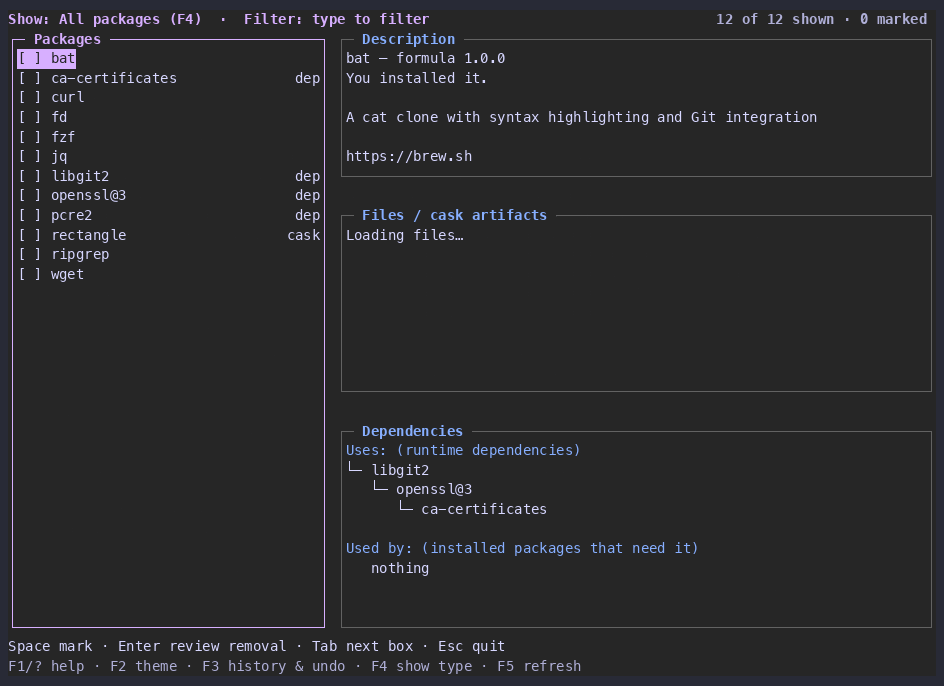

# brew-cleanup

[](https://github.com/dewab74/brew-cleanup/actions/workflows/ci.yml)
[](https://github.com/dewab74/brew-cleanup/actions/workflows/release.yml)
[](https://github.com/dewab74/brew-cleanup/releases/latest)
[](https://github.com/dewab-org/homebrew-custom)
[](#install)
[](#install)
[](#install)
[](https://github.com/dewab74/brew-cleanup/attestations)
[](LICENSE)

A terminal interface for removing installed Homebrew packages, with a searchable
package list, three separate detail boxes on the right, and a timestamped
history you can use to reinstall what was removed.

Supports formulae and casks on macOS, and formulae on Linux. Requires Python 3.9+
(standard library with curses) and Homebrew on `PATH`. No fzf or pip packages are needed.
The terminal must be at least 80 columns by 24 rows.

## Demo

[](docs/demo.mp4)

Recorded with asciinema using simulated packages; no real Homebrew packages are changed.
[Watch the MP4](docs/demo.mp4) or replay the [original asciinema recording](docs/demo.cast):

```sh
asciinema play docs/demo.cast
```

The recording shows the key help, switching the list between formulae, casks, dependencies
and unused dependencies, filtering and marking two packages, the removal review with its
autoremove estimate, removal, history, undo, and switching between Mocha and Latte.
See [docs/DEMO.md](docs/DEMO.md) to reproduce it.

## Install

With Homebrew, from the [dewab-org/custom](https://github.com/dewab-org/homebrew-custom) tap:

```sh
brew tap dewab-org/custom
brew install dewab-org/custom/brew-cleanup
brew-cleanup --dry-run
```

Homebrew 7 and newer may ask you to trust the tap first:
`brew trust --formula dewab-org/custom/brew-cleanup`.

Or run it from a clone (keep the launcher and all Python modules together):

```sh
git clone https://github.com/dewab74/brew-cleanup.git
cd brew-cleanup
./brew-cleanup --dry-run
./brew-cleanup
```

`brew cleanup` (with a space) is Homebrew's own cache-cleaning command and is unrelated.

## Use

Press **F1** or **?** in the browser for the full key list.

- Type to filter by name (letters in order, so `ossl` finds `openssl@3`).
- **F4** / **Shift-F4** switches what the list shows: all packages, formulae, casks,
  packages you installed, dependencies, or **unused dependencies** (what `brew autoremove`
  would remove right now).
- **Space** marks the highlighted package; **Ctrl-A** / **Ctrl-D** mark or unmark every
  package shown. Marks survive filtering.
- **Enter** reviews the marked packages (or the highlighted one if nothing is marked).
- **Tab / Shift-Tab** moves focus to the right-hand boxes; **Up/Down** and **Page Up/Down**
  then scroll that box.
- **Esc** clears the filter and view first, then quits. If packages are still marked it
  asks before quitting. **Ctrl-Z** suspends.
- **F2** theme, **F3** history and undo, **F5** reload installed packages.

In the list, `dep` marks a formula Homebrew installed automatically as a dependency, and
`cask` marks a macOS app. The description box says why each package is installed.

The left pane shows package names and types only. Three independently bordered boxes
on the right show the highlighted package's **Description**, **Files / cask artifacts**,
and **Dependencies**. Each box has its own scroll position. File lists load in the
background and are cached for the browser session.

The dependency box contains two trees: **Depends on** and **Required by**. Formula edges
come from direct runtime dependencies in installed receipts, with declared dependencies
as a fallback for older metadata. Casks use their declared formula/cask dependencies.
Reverse dependencies include installed packages only; build/test-only dependencies and
OS requirements are excluded. Shared branches and cycles are marked instead of repeated.
This is an inventory snapshot; Homebrew's uninstall checks remain authoritative.

For casks, Homebrew lists installed artifacts rather than every file inside an app bundle.

Review, command output, prompts, errors, and results appear in popup boxes. The browser
stays open and refreshes after each operation, including partial failures. The review
names each package and version, warns about packages Homebrew will refuse to remove
because other installed packages still need them, and estimates which unused
dependencies `brew autoremove` will take afterwards. Press **Y** to go ahead, or **N** /
**Esc** to cancel; **Enter** on the default Cancel button does nothing.

The progress popup streams Homebrew output in a private pseudo-terminal; type directly
to answer prompts, including password prompts if a cask requires authentication. Password
input is not separately echoed or saved by this tool; the subprocess controls echo.
**Ctrl-C** requests an interrupt and waits for the command and final inventory snapshot.
Do not close the terminal while an operation is running. **Up/Down** scrolls the output;
**End** resumes following new output. Close the result popup to return to the browser.

After confirmation, the tool runs typed `brew uninstall --cask` / `--formula` commands,
then `brew autoremove`. Homebrew's normal dependency checks remain enabled; the tool
never uses `--force`, `--ignore-dependencies`, or `--zap`. An uninstall failure stops
execution before autoremove and records any partial removals.

**Autoremove removes all unused dependencies**, including ones orphaned before this
session. They are included in the history. The review's autoremove list is an estimate
from install receipts; Homebrew decides. `--dry-run` shows the review without running it.

## Themes

**Catppuccin Mocha** is the default. **F2** offers `catppuccin-mocha`, `catppuccin-latte`,
and `terminal` (your terminal's own ANSI colors). The palette colors package marks,
focused panes, dependency headings, action buttons, progress, errors, and success states.
Theme choice is saved to `$XDG_CONFIG_HOME/brew-cleanup/config.json`, falling back to
`~/.config/brew-cleanup/config.json`.

```sh
./brew-cleanup --theme catppuccin-mocha
./brew-cleanup --theme catppuccin-latte
./brew-cleanup --theme terminal
```

`--theme` overrides the saved preference for that launch. The F2 picker saves a new
preference. Direct-color terminfo uses Catppuccin's RGB values;
other terminals use the nearest supported colors, with a monochrome fallback. The UI
never reprograms your terminal's color palette. Colors follow the
[official Catppuccin palette](https://github.com/catppuccin/palette).

## History and undo

Press **F3** in the browser to list past removals and reinstalls by date, with the
packages involved. Press **Enter** for details, **U** to review an undo, or **R** (shown
only when needed) to recover an interrupted transaction. All three stay
inside popup dialogs. Dry-run mode also prevents undo and recovery writes.
The existing shell commands remain available:

```sh
./brew-cleanup history
./brew-cleanup undo 20261119T210000Z-0123abcd  # use an actual ID from history
```

Each removal saves the complete installed inventory before and after, selected packages,
commands, UTC timestamps, status, and the packages actually removed, including dependencies.
Undo reinstalls missing packages from that transaction and skips those already installed.
Undo attempts also have their own history entries. If a reinstall fails, fix the cause and
retry the original removal ID; already restored packages will be skipped.

History lives in `$XDG_STATE_HOME/brew-cleanup/history`, or
`~/.local/state/brew-cleanup/history` by default. JSON records are atomically replaced
with owner-only file permissions. They stay outside this repository. Back up this directory
if you want a durable removal ledger. The timestamp is the operation's start/end time,
not a separate clock reading for each removed dependency.

If the process is killed before its final snapshot, inspect the record and run:

```sh
./brew-cleanup recover TRANSACTION_ID
./brew-cleanup undo TRANSACTION_ID
```

Recovery compares the saved inventory with the current installation and asks you to approve
that comparison. Packages removed by unrelated commands since then may appear in the result.
Avoid running other Homebrew operations during cleanup or recovery. The tool locks out other
instances of itself, but cannot lock out independent `brew` commands.

### What undo means

Undo is a **best-effort reinstall**, not a system rollback:

- It installs the versions currently available from Homebrew, not historical binaries.
- Removed/renamed/disabled packages or unavailable taps can require manual intervention.
- It does not restore application data, configuration, services, pins, install options,
  or the original dependency/requested-install flags. Reinstalled dependencies may become
  explicitly requested packages and therefore remain after later autoremove runs.
- A package with another version still installed is not considered removed. Before/after
  snapshots retain version details, but undo does not restore individual missing kegs.
- Cask uninstall scripts can have their own effects; not using `--zap` is not a backup.

## Development

```sh
brew install pre-commit
make hooks
make check
```

`make test` runs isolated tests without changing real Homebrew packages. `make lint` runs
Ruff, Markdown and shell linting, repository hygiene, gitleaks, and detect-secrets.
Hooks run locally before commits; GitHub Actions repeats them as a backstop and tests
Python 3.9 on Ubuntu 22.04 and Python 3.13 on current macOS and Ubuntu runners.
Hook and action versions are pinned.

### Releasing

1. Bump `__version__` in `brew_cleanup.py`.
2. Re-record the README demo with `make demo` (needs `brew install asciinema agg ffmpeg`).
   Watch `docs/demo.gif`, then commit `docs/demo.cast`, `demo.gif` and `demo.mp4`.
   The recording's title carries the version, and the release refuses a tag whose
   demo was not recorded for it.
3. Merge to `main`, then push a matching tag:

```sh
git tag v0.1.0 && git push origin v0.1.0
```

The release workflow checks the tag is on `main`, matches `__version__` and the demo, runs the tests
and hooks, builds a deterministic source archive with `scripts/build_release.py`, attests
its provenance, and publishes a GitHub release. A last job renders
`Formula/brew-cleanup.rb` from the published checksum and pushes it to the
dewab-org/homebrew-custom tap with a deploy key (`TAP_DEPLOY_KEY` in the `homebrew-tap`
environment). Pre-release tags (`v1.2.0-rc1`) skip the tap, and the tap never moves to an
older version.

See [PLAN.md](PLAN.md) for design decisions, [TODO.md](TODO.md) for verification and
future work, and [SECURITY.md](SECURITY.md) for security reporting.

## References

The command behavior follows the [Homebrew manual](https://docs.brew.sh/Manpage);
the browser uses Python's built-in curses terminal UI.

## License

[MIT](LICENSE).
